# C4 Container — Finance Platform

Nível 2 (Containers): serviços executáveis, stores e brokers, com tecnologias
e protocolos. Reflete a stack Terraform (`terraform/`) e o ambiente local
(`docker-compose/`).

```mermaid
C4Container
  title Containers — Finance Platform (AWS, stack Terraform)

  Person(cliente, "Cliente / Estabelecimento")

  Container_Boundary(vpc, "AWS — VPC finance-platform (2 AZs, subnets públicas, sem NAT)") {
    Container(alb, "ALB", "Application Load Balancer", "HTTP:80 → target group /health,3000; alarme 5xx")

    Container_Boundary(ecs, "ECS Fargate (cluster finance-platform, 0.25 vCPU/512MB)") {
      Container(authz, "Authorization Service", "Node/NestJS, container", "API REST OpenAPI v1; single-table DynamoDB; TransactWriteItems + outbox (ADR-003/004/006)")
      Container(acct, "Accounting Consumer", "Node, container", "SQS long polling; ledger DynamoDB; dedup event_id (backend dynamodb)")
      Container(fraud, "Fraud Consumer", "Node, container", "SQS long polling; decisão mock (FRAUD_MOCK_RESULT); dedup event_id")
      Container(notif, "Notification Consumer", "Node, container", "SQS long polling; gateway mock; dedup event_id")
    }

    Container(relay, "Outbox Relay", "Lambda Node 22", "DynamoDB Streams (INSERT OUTBOX#*) → PutEvents; preserva event_id (ADR-006)")

    ContainerDb(ddb, "DynamoDB single-table", "DynamoDB PAY_PER_REQUEST", "PK/SK: CONTRACT#, AUTH#, IDEMPOTENCY#, OUTBOX#; GSI gsi-auth; TTL ttl; Streams NEW_IMAGE")
    ContainerDb(entries, "accounting-entries", "DynamoDB", "Ledger idempotente por event_id")
    ContainerDb(idem, "consumer-idempotency", "DynamoDB + TTL expires_at", "Dedup compartilhada dos consumers (ADR-007)")

    Container(bus, "EventBridge bus", "EventBridge custom bus", "Regra TransacaoAutorizada → fan-out 3 filas (ADR-005)")

    ContainerQueue(qa, "accounting-queue", "SQS + DLQ", "redrive maxReceiveCount=5; alarme depth>0")
    ContainerQueue(qf, "fraud-queue", "SQS + DLQ", "redrive maxReceiveCount=5; alarme depth>0")
    ContainerQueue(qn, "notification-queue", "SQS + DLQ", "redrive maxReceiveCount=5; alarme depth>0")

    Container(cw, "CloudWatch", "Logs + Alarmes", "4 log groups ECS + relay; SNS finance-platform-alarms")
  }

  Rel(cliente, alb, "POST /v1/contratos/{id}/autorizacoes", "HTTP/JSON + Idempotency-Key")
  Rel(alb, authz, "forward (health /health:3000)", "HTTP")
  Rel(authz, ddb, "TransactWriteItems: limite+autorização+idempotência+outbox", "AWS SDK")
  Rel(ddb, relay, "Streams (INSERT)", "event source mapping")
  Rel(relay, bus, "PutEvents (source/detail-type/time, detail=payload)", "AWS SDK")
  Rel(bus, qa, "regra TransacaoAutorizada", "envelope c/ detail")
  Rel(bus, qf, "regra TransacaoAutorizada", "envelope c/ detail")
  Rel(bus, qn, "regra TransacaoAutorizada", "envelope c/ detail")
  Rel(qa, acct, "ReceiveMessage/DeleteMessage", "long polling 20s")
  Rel(qf, fraud, "ReceiveMessage/DeleteMessage", "long polling 20s")
  Rel(qn, notif, "ReceiveMessage/DeleteMessage", "long polling 20s")
  Rel(acct, entries, "PutItem (idempotente por event_id)", "AWS SDK")
  Rel(acct, idem, "dedup event_id", "AWS SDK")
  Rel(fraud, cw, "logs JSON", "awslogs")
  Rel(authz, cw, "logs JSON", "awslogs")
```

## Diferenças no ambiente local (docker-compose)
| Container AWS            | Equivalente local                          |
| ------------------------ | ------------------------------------------ |
| EventBridge bus + regra  | **ausente** (LocalStack Pro) — ver abaixo  |
| Lambda outbox relay      | `outbox-relay-local` (Node, mesmo filtro `entity=OUTBOX`) |
| Fan-out bus→3 filas      | fan-out direto relay→3 filas SQS, **mesmo envelope** (`detail`) — ADR-006 adapter equivalente |
| ALB                      | ausente — `localhost:3000` direto          |
| DynamoDB/SQS             | LocalStack community (`init/init-localstack.sh` cria os mesmos recursos) |
