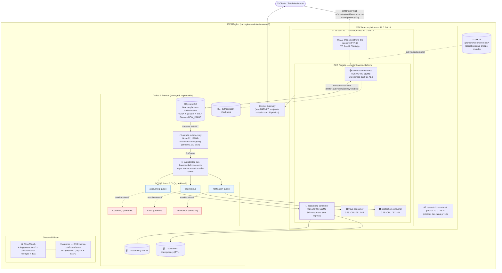

# Deploy AWS — stack Terraform

Topologia física da stack (`terraform/`): região única, VPC com 2 AZs e
subnets públicas (sem NAT — custo mínimo), ECS Fargate, ALB, DynamoDB,
Lambda, EventBridge, SQS e CloudWatch.

## Mapeamento arquivo → recursos

| Arquivo Terraform   | Recursos no diagrama                                       |
| ------------------- | ----------------------------------------------------------- |
| `network.tf`        | VPC, IGW, subnets, route table, SGs (alb/auth/consumers)    |
| `alb.tf`            | ALB, target group `/health:3000`, listener HTTP:80          |
| `ecs.tf`            | cluster, 4 task defs, 4 services, circuit breaker+rollback  |
| `dynamodb.tf`       | 4 tabelas (single-table, checkpoint, entries, idempotency)  |
| `lambda.tf`         | Lambda relay + event source mapping + log group             |
| `eventbridge.tf`    | bus custom + regra de fan-out + 3 targets                   |
| `sqs.tf`            | 3 filas + 3 DLQs + redrive + queue policies                 |
| `iam.tf`            | execution role, task roles, relay role (least privilege)    |
| `cloudwatch.tf`     | log groups ECS, alarmes DLQ/5xx, SNS topic                  |
| `outputs.tf`        | ALB DNS, filas, tabelas, bus, topic                         |

**Custo mínimo**: sem NAT (~US$ 32/mês evitados por AZ), sem VPC endpoints,
Container Insights desligado, Fargate 0.25/512 com desired_count=1, PAY_PER_REQUEST,
retenção de logs 7 dias. Único custo fixo relevante: ALB (~US$ 16/mês) —
para demo, `terraform apply` → usar → `terraform destroy`.
